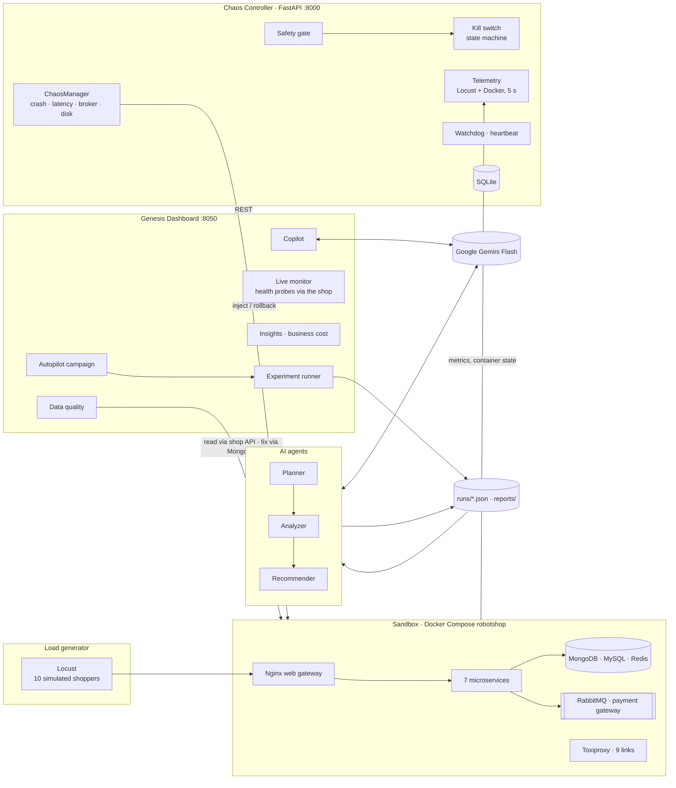
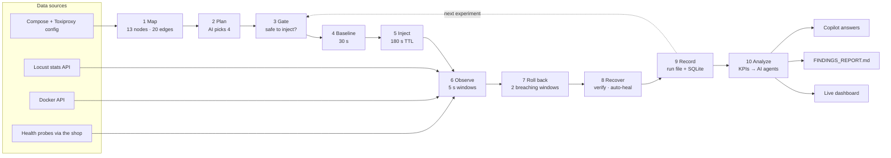

# Genesis: AI-Driven Chaos Engineering for Cloud-Native Resilience

**Team Genesis (Team 24) · MIT Bengaluru · Bosch Hackathon**

Genesis is an AI that breaks a cloud-native application on purpose, safely, and tells you exactly how to make it
stronger. On a sandboxed microservices shop it **plans** which failure to try from a dependency map, **injects** it
behind a safety gate and kill switch, **observes** errors, latency and health every 5 seconds, **rolls back**
automatically, and **reports** ranked weaknesses with verifiable fixes and a resilience score. A data-quality
add-on does the same for the data customers type in: it detects null, duplicate, inconsistent and mismatching
records, fixes what is safe and shows the result before and after.

| | |
| --- | --- |
| **Target application** | [Stan's Robot Shop](https://github.com/instana/robot-shop) (Apache 2.0): 15 containers, 7 services in 5 languages |
| **One click** | Autopilot runs 4 AI-chosen experiments end to end and writes the findings report |
| **Safety** | 33 of 33 recorded runs rolled back automatically, every rollback verified |
| **Proven fix** | A second catalogue replica cut error-minutes by **98.9 %** (two-proportion z-test, p = 2.8 × 10⁻⁸) |
| **AI** | Planner → Analyzer → Recommender agents on Google Gemini Flash, grounded in measured numbers |
| **Data quality** | Null, duplicate, inconsistent and discrepant customer data detected, fixed, shown before vs after |
| **Tests** | 178 automated tests |

---

## Contents

1. [Architecture](#architecture)
2. [How data flows through the pipeline](#how-data-flows-through-the-pipeline)
3. [Features](#features)
4. [Data quality of customer-entered data](#data-quality-of-customer-entered-data)
5. [Run it](#run-it)
6. [Results](#results)
7. [Tools and where they are used](#tools-and-where-they-are-used)
8. [Repository layout](#repository-layout)
9. [Testing](#testing)
10. [Team](#team)

---

## Architecture



| Part | Responsibility |
| --- | --- |
| **Sandbox** (`sandbox/`) | Robot Shop with memory caps, Toxiproxy on 9 service links, Locust load, `target` labels so only sandbox containers can be touched, a fixed web config so page refreshes work |
| **Chaos controller** (`controller/main.py`, `faults/`, `kill_switch.py`, `telemetry.py`, `watchdog.py`) | REST API (map, plan, inject, rollback, safety), the safety gate, the kill-switch state machine, fault injectors, telemetry, the watchdog, SQLite state |
| **AI agents** (`controller/agents/`) | Planner ranks experiments, Analyzer explains and scores, Recommender proposes verifiable fixes; one guarded Gemini client with a grounding check, PII masking, caching and a rule-based fallback |
| **Dashboard** (`controller/insights/`) | Autopilot, live map coloured by phase, proof of downtime, run-to-run comparison with significance tests, business cost, AI report, data quality, Copilot |

## How data flows through the pipeline



Steps 3–9 repeat for each experiment (about 2 minutes each); step 10 runs once at the end. Emergency stop rolls
everything back at any step.

## Features

### Autonomous chaos campaign
One click on **Start autopilot**. The Planner scores every candidate experiment:

```
score = 100 × (0.40 revenue proximity + 0.25 novelty + 0.20 blast radius + 0.15 new fault type)
```

Revenue proximity is `1 / (1 + hops from payment)`. Gemini re-ranks the list and writes a one-line reason; unknown
experiments and invented numbers are rejected. The default campaign: payment crash, payment → gateway latency
(+2 s), RabbitMQ stop, catalogue crash.

### Failure scenarios

| Failure type | How it is injected | Status |
| --- | --- | --- |
| Service crash | stop the container; rollback starts it | run in every campaign |
| Network delay | Toxiproxy latency + jitter on one service link | run in every campaign |
| Dependency failure | stop the RabbitMQ app inside its container | run in every campaign |
| Full disk | bounded tmpfs fill (cannot touch the real disk) | implemented |
| Combined failures | two faults on distinct services (`/api/v1/inject/combined`) | implemented |

### Safety controls

| Stop condition | Automatic action |
| --- | --- |
| Error rate above 5 % for 2 consecutive 5 s windows | kill switch trips, fault rolled back |
| p95 latency above 5× baseline for 2 windows | kill switch trips, fault rolled back |
| Load telemetry missing (running blind) | kill switch trips, fault rolled back |
| Fault still active after its TTL (180 s) | controller rolls it back |
| Emergency stop pressed | trip, roll back every fault, stop the run |
| Controller heartbeat lost | watchdog restores containers, clears toxics, aborts intents |
| Container still down after rollback | auto-heal restart, logged as a finding |

Before any fault, the safety gate requires a captured baseline, an idle kill switch, every container healthy and a
target labelled as sandbox.

### Measurement
Every number is computed in Python from the run files; the AI only explains.

| Metric | Definition |
| --- | --- |
| Time to detect | fault injected → second of two breaching 5 s windows |
| Time to recover | rollback → two clean windows (errors < 2 %, p95 within limit) |
| Error-minutes (primary KPI) | Σ error rate × window length ÷ 60 over fault + recovery |
| Severity (0–100) | 100 × (0.4 error spike + 0.3 incident time ÷ 180 s + 0.3 services hit ÷ 7) + up to 20 for slowdowns |
| Resilience (0–10) | 0.4 latency + 0.4 errors + 0.2 recovery per experiment; overall = mean |
| Significance | pooled two-proportion z-test on failed ÷ total requests; changes count only if p < 0.05 |

### Dashboard (http://127.0.0.1:8050)
- **Live**: autopilot, a dependency map coloured by phase (baseline, fault, at risk, recovering, recovered), a
  plain-language event feed, notifications, a live error chart and UP/DOWN proof for each service through the shop.
- **Experiments**: did things get better or worse, with significance tests and run timelines.
- **Business impact**: cost per incident and per year from measured outage time (assumptions editable).
- **AI report**: the multi-agent findings report with Markdown and JSON download.
- **Data quality**: see below.
- **Copilot**: a floating chat answering from the measured runs (Gemini, masked, cached).

## Data quality of customer-entered data

Robot Shop's user service only checks that name, password and email are present (its register handler still has
`// TODO - validate email address format`), its duplicate check is an exact name match, and orders are stored
exactly as sent. So customers can enter data that is inconsistent, duplicated, null, or whose amounts do not add up.
The **Data quality** tab detects these problems, fixes what is safe, and shows the data before and after the fix.

| Problem type | Data-quality dimension | Examples detected |
| --- | --- | --- |
| **Null / missing** | completeness | blank email or name, order without id, item without quantity or price |
| **Duplicate** | uniqueness | the same customer twice (name or email equal after trimming and lower-casing); the same order stored twice |
| **Inconsistent / invalid** | consistency, validity | stray spaces or capitals, invalid email, unknown product, quantity not a whole number above 0 |
| **Discrepancy** | accuracy | price differs from the catalogue; subtotal ≠ price × qty; total ≠ sum of subtotals; tax ≠ total − total ÷ 1.2 |

**Fix policy: never guess.**
- **Fixed automatically:**
  - normalised names and emails;
  - duplicate customers merged into the first registration, with their orders moved;
  - duplicate orders removed;
  - amounts recomputed from the catalogue price;
  - a recovery id for an order without one;
  - an email typo with doubled separators (`@@`, `..`) collapsed, only if the result is valid.
- **Flagged for a human** (`dq_status: needs_review`), because a fix would need a guess:
  - missing or unrepairable email;
  - missing or invalid quantity;
  - unknown product.

**How it works.**
1. **Read:** customer and order data come from the shop's own API, like a client would read them. Passwords are dropped on read and never shown.
2. **Fix:** fixes are written to the sandbox MongoDB, only for records in the fresh snapshot, after a backup of every affected document to `runs/dataquality/` (git-ignored).
3. **Show:** emails are partly masked on screen, with stray spaces marked `␣` so formatting problems stay visible.

**Demo flow** (Data quality tab):
1. **Simulate messy customer input** registers demo customers (`dq-…`) and orders through the shop's real
   register and order endpoints. The shop accepts all of them.
2. **Scan** lists every problem with its type, record, field, before value, proposed after value and rule.
3. **Fix** (click twice) applies the safe fixes and re-scans. Example from the sandbox:

   | | Before | After |
   | --- | --- | --- |
   | Quality score (records without a problem) | 40 % | 69.2 % |
   | Null / missing | 4 | 3 (flagged) |
   | Duplicate | 2 | 0 |
   | Inconsistent / invalid | 6 | 1 (flagged) |
   | Discrepancy | 4 | 0 |
   | Auto-fixable problems left | 12 | **0** |

4. **Reset demo data** removes the `dq-…` customers again. The seeded shop accounts are never changed.

Code: `controller/insights/dataquality.py` (rules, fix plan, masking), `controller/insights/dataquality_shop.py`
(read, inject, write), API `POST /api/data/{inject,scan,fix,reset}` and `GET /api/data/last` on the dashboard.

## Run it

Requirements: Docker Desktop (or OrbStack) with Compose, Python 3.10+ for the dashboard and scripts, and a Gemini API
key for the AI features (everything works without one, with rule-based output).

```bash
# 1. API key in the git-ignored root .env (never in .env.example)
cp .env.example .env            # Windows: copy .env.example .env, then set GEMINI_API_KEY

# 2. sandbox (Robot Shop, Locust, Toxiproxy) and controller
docker compose -f sandbox/docker-compose.yaml -f sandbox/docker-compose.override.yml up -d --wait
docker compose --env-file .env -f controller/docker-compose.yml up -d --build

# 3. dashboard
pip install fastapi uvicorn pydantic
cd controller && python -m insights.dashboard.server
```

With `make` installed: `make up`, then `make dashboard`. Then open:

| What | URL |
| --- | --- |
| Genesis dashboard | http://127.0.0.1:8050 (the controller's `/dashboard` redirects here) |
| Robot Shop | http://127.0.0.1:8080 (demo logins: `stan` / `bigbrain`, `user` / `password`) |
| Locust | http://127.0.0.1:8089 |
| Controller API docs | http://127.0.0.1:8000/docs |

If the controller says "Capture a steady-state baseline": `curl -X POST "http://127.0.0.1:8000/api/v1/baseline?duration=60"`.

**From the terminal:**

```bash
python scripts/autopilot.py                     # the autonomous campaign (Ctrl+C = emergency stop)
python scripts/day1_demo.py --fault container_crash --target payment
python scripts/apply_fix.py replicas --service catalogue --count 2   # then re-run with --label "fix: ..."
cd controller && python -m agents report        # multi-agent findings report
```

A step-by-step demo and rehearsal checklist is in [`docs/DEMO_RUNBOOK.md`](docs/DEMO_RUNBOOK.md).

## Results

From the latest autonomous campaign (Robot Shop sandbox, 11 Oct 2026):

| Experiment | Detected | Recovered | Peak errors | Latency change |
| --- | ---: | ---: | ---: | --- |
| Payment crash | 55.7 s | 16.0 s | 100 % | p95 47 ms → 37 s |
| Payment → gateway +2 s | 16.4 s | 15.8 s | 0 % | checkout 15 ms → 4.2 s |
| RabbitMQ stopped | 31.3 s | 10.4 s | 7.5 % | p95 77 → 150 ms |
| Catalogue crash | 68.7 s | 26.9 s | 100 % | p95 39 ms → 60 s |

- **Overall resilience:** 4.93 / 10. The top weaknesses are the catalogue crash (severity 86.9), the MongoDB crash
  (82.2) and the payment crash (77.2).
- **Recommended fixes:** circuit breakers, shorter timeouts, more replicas and a durable queue, covering $61,295 a
  year of projected exposure.
- **Hidden cascade found:** when RabbitMQ stopped, dispatch crashed and never restarted by itself. The pipeline now
  auto-heals it and records it as a finding.
- **Reports:** full report in [`FINDINGS_REPORT.md`](FINDINGS_REPORT.md); raw evidence in `runs/day1_*.json`.

## Tools and where they are used

| Category | Tool | Where it is used |
| --- | --- | --- |
| Language | Python 3.11 | controller, AI agents, dashboard, scripts |
| Framework | FastAPI + Uvicorn, Pydantic | controller API (:8000), dashboard (:8050) |
| Storage | SQLite, SQLAlchemy, Alembic | experiment intents, telemetry, results |
| UI | HTML, JavaScript, Chart.js | dashboard |
| Reporting | Jinja2, Typer, Rich | report template and CLI |
| AI model | Google Gemini Flash (`google-genai`, REST) | planner re-rank, analyzer, recommender, Copilot, business brief |
| AI safety | grounding check, PII masker, cache + daily cap | every AI call |
| Containers | Docker Desktop, Docker Compose, Docker SDK for Python | sandbox and controller stacks; crash faults, container state |
| Fault injection | Toxiproxy, rabbitmqctl, tmpfs | latency on 9 links; broker stop; bounded disk fill |
| Load and observability | Locust, health probes, watchdog | traffic, live error/latency stats, UP/DOWN proof, controller heartbeat |
| Target | Stan's Robot Shop (Instana, Apache 2.0) | the system under test |
| Testing | pytest, pytest-asyncio | 178 automated tests |

## Repository layout

```
sandbox/                 Robot Shop compose + overrides, Toxiproxy config, Locust, web (nginx) template
controller/
  main.py                controller REST API (FastAPI)
  faults/                fault injectors + ChaosManager
  kill_switch.py         kill-switch state machine     telemetry.py   Locust + Docker telemetry
  watchdog.py            dead-man watchdog              planner.py     dependency-based planner
  agents/                Planner, Analyzer, Recommender, Coordinator (multi-agent report)
  insights/              dashboard server + UI, run comparison, business impact, live monitor,
                         data quality, PII masking, Gemini client
  tests/                 unit and integration tests
scripts/                 day1_demo.py (one measured experiment), autopilot.py, apply_fix.py
runs/                    recorded experiment evidence (day1_*.json)
reports/                 generated findings report (Markdown + JSON)
docs/                    DEMO_RUNBOOK.md, INSIGHTS.md, M1_PLATFORM.md, ...
```

## Testing

```bash
python -m pip install -r controller/requirements-dev.txt
cd controller && python -m pytest -q        # or: make test
```

All 178 tests run without Docker or a Gemini key: Docker, HTTP and model calls are faked, and no test can read a real
API key.

## Team

**Team Genesis · Team 24 · MIT Bengaluru · batch 2027**

| Member | Roll number | Role |
| --- | --- | --- |
| Hemang Agarwal | 235816156 | M1 Platform: sandbox, autopilot, AI agents, dashboard, data quality |
| Utkrisht Sharma | 235816488 | M2 AI backend: controller API, AI planner, database |
| Pavan Kotian | 235890192 | M3 Chaos engineering: fault injectors, ChaosManager |
| Sameer Sharma | 235816400 | M4 Safety and observability: kill switch, telemetry, watchdog |
| Anna Sathish | 235890046 | M5 Reporting: resilience scoring, reports, CLI |

Everything runs inside the team's local sandbox. Real or production systems, shared infrastructure and other
participants' environments are out of scope.
